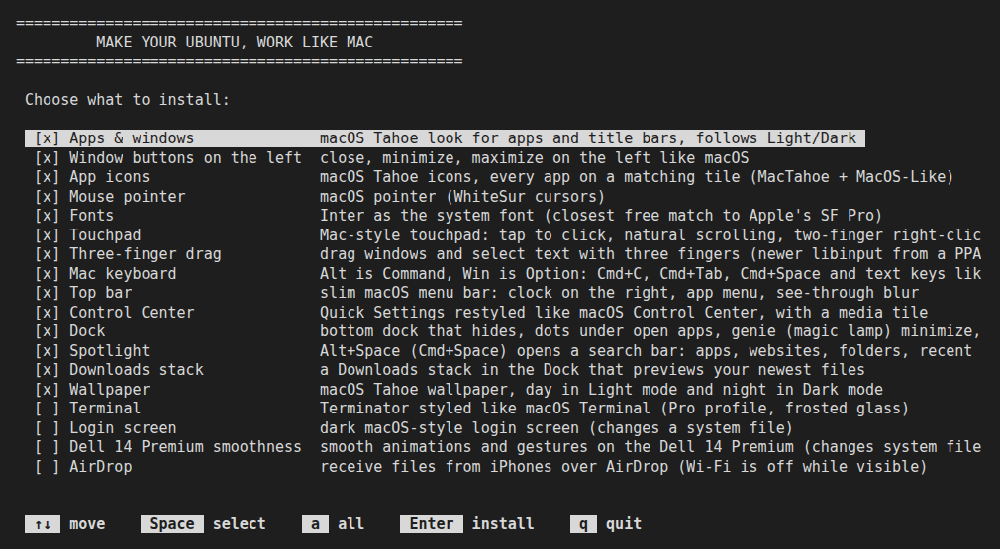
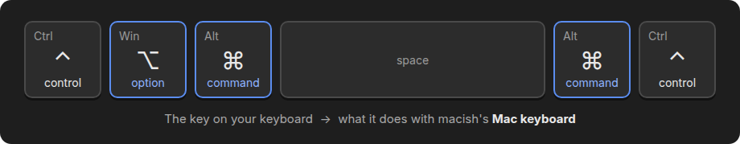

# macish

**Make your Ubuntu look, and work, like a Mac.**


macish turns a standard Ubuntu desktop into a macOS Tahoe look-alike, one feature at a time:
the theme, icons, dock and menu bar, but also the things you'd miss from a Mac: Command, Option
and Control where a Mac has them, with Cmd+C, Cmd+Tab and the other shortcuts; Spotlight;
trackpad gestures and three-finger drag; window tiling with Ctrl+Option+arrows; Touch ID with
your fingerprint reader; and receiving files from an iPhone over AirDrop. You choose the features from a list, and every one of them
can be removed again, putting your earlier settings back.



## Contents

- [Features](#features)
- [Quick start](#quick-start)
- [Using the installer](#using-the-installer)
- [Requirements](#requirements)
- [Mac keyboard](#mac-keyboard)
- [Touch ID](#touch-id)
- [AirDrop](#airdrop)
- [Uninstalling](#uninstalling)
- [What it changes on your system](#what-it-changes-on-your-system)
- [Troubleshooting](#troubleshooting)
- [For developers](#for-developers)
- [Credits](#credits) · [License](#license)

## Features

**Look like a Mac**

| Feature | id | What you get | Default |
|---|---|---|---|
| Apps & windows | `app-theme` | [MacTahoe](https://github.com/vinceliuice/MacTahoe-gtk-theme) theme for apps and title bars, with extra contrast for sidebars and lists | on |
| Window buttons on the left | `window-buttons` | close, minimize, maximize on the left | on |
| App icons | `icons` | [MacTahoe](https://github.com/vinceliuice/MacTahoe-icon-theme) icons; [MacOS-Like](https://github.com/Scrimas/MacOS-Like) puts every other app on a matching tile | on |
| Mouse pointer | `cursors` | [WhiteSur cursors](https://github.com/vinceliuice/WhiteSur-cursors) | on |
| Fonts | `fonts` | Inter, the closest free font to Apple's SF Pro, for menus, windows and title bars | on |
| Top bar | `top-bar` | slim menu bar, clock on the right, no Activities button, a menu with About, Force Quit and power options, see-through when no window touches it | on |
| Control Center | `control-center` | Quick Settings restyled like macOS Control Center, with a media tile | on |
| Dock | `dock` | at the bottom, hides when a window needs the space, dots under open apps, "genie" minimize, snappier animations | on |
| Downloads stack | `downloads-stack` | a Downloads stack next to the Trash that previews your newest files; click for a grid (needs Ubuntu Dock) | on |
| Wallpaper | `wallpaper` | Tahoe wallpaper: day in Light mode, night in Dark mode | on |
| Terminal | `terminal` | Terminator dressed as macOS Terminal "Pro", with frosted glass | off |
| Login screen | `login-screen` | dark macOS-style login screen (changes a system file) | off |

**Work like a Mac**

| Feature | id | What you get | Default |
|---|---|---|---|
| Touchpad | `touchpad` | tap to click, natural scrolling, two-finger click or tap for right-click, ignored while typing. Gestures through [Touchpad Gesture Customization](https://extensions.gnome.org/extension/7850/): three or four fingers sideways switch desktops, up and down open the overview, a four-finger pinch shows the desktop | on |
| Mac keyboard | `keyboard` | the keys next to the space bar work like a Mac's: Ctrl, Win, Alt become Control, Option, Command. Cmd+C, Cmd+Tab, Cmd+Space, Cmd+Q, text navigation, Option's characters (Option+L is @ on German) and more ([details](#mac-keyboard)) | on |
| Touch ID | `touch-id` | your fingerprint logs you in, unlocks the screen, and approves sudo in a terminal and admin prompts ([details](#touch-id)) | on |
| Three-finger drag | `three-finger-drag` | drag windows and select text with three fingers (newer libinput from a PPA, Ubuntu 24.04 only) | on |
| Window tiling | `windows` | tiling like macOS Sequoia, through Ubuntu's Tiling Assistant: drag a window to an edge for a half, a corner for a quarter, the top to fill, without Windows' Snap Assist popup; <kbd>Ctrl</kbd>+<kbd>Option</kbd>+arrows, F, C, R tile, fill, center and restore it, and carry a tiled window on to the next monitor; Ctrl+Option+Enter is full screen; Ctrl+Cmd+drag moves it from anywhere ([shortcuts](#mac-keyboard)). On PC keys: Super+arrows, Ctrl+Super+↑ / ↓ / C / Enter, Super+Shift+arrows to another monitor, Super+drag | on |
| Spotlight | `spotlight` | <kbd>Alt</kbd>+<kbd>Space</kbd> (Cmd+Space with the Mac keyboard: the same keys) opens a search bar: apps, websites and Google searches in Chrome, folders (type `~/` or `/`, <kbd>Tab</kbd> goes in), recent searches | on |
| AirDrop | `airdrop` | receive files from iPhones, iPads and Macs over real AirDrop, with Accept and Decline in a notification ([details](#airdrop)) | off |

**Optional, and not Mac features.** They fix things on some computers and have nothing to do with
macOS; they are off until you tick them.

| Feature | id | What you get | Default |
|---|---|---|---|
| Screen layout | `displays` | after a docking station reconnects, your primary screen, the screens' positions and scales come back: GNOME saves them per connector, and a dock hands out new connectors every time. macish remembers them per monitor instead ([details](#what-it-changes-on-your-system)) | off |
| Dell 14 Premium smoothness | `dell-smooth` | smoother animations and gestures on the Dell 14 Premium (DA14250): newer Intel GPU firmware, the NVIDIA GPU sleeps when it isn't used, GNOME's power modes reach Dell's thermal modes | off |

The installer only offers the features this computer supports. **Light and Dark** follow
Settings → Appearance as usual: a small user service, `like-a-mac-sync`, switches the app theme,
icons, top bar and Control Center along with it.

## Quick start

```sh
git clone https://github.com/adithyakumarcr/macish.git
cd macish
./install.sh
```

Tick what you want, press <kbd>Enter</kbd>, give your password if asked, then log out and back in.

## Using the installer

Run it as yourself, **not** with `sudo`. A list of features opens under
**MAKE YOUR UBUNTU, WORK LIKE MAC**:

| Key | Does |
|---|---|
| <kbd>↑</kbd> <kbd>↓</kbd> | move |
| <kbd>Space</kbd> | tick `[x]` or untick `[ ]` a feature |
| <kbd>a</kbd> | tick or untick everything |
| <kbd>Enter</kbd> | install what's ticked |
| <kbd>q</kbd> | quit without changing anything |

If anything you ticked needs your password (some features do, and so do packages to install), it's
asked **once**, right after <kbd>Enter</kbd>, and the rest installs without stopping. When it's done,
log out and back in.

From the command line:

```sh
./install.sh --list                      # every feature, and which are installed
./install.sh --only icons,dock,top-bar   # install just these, without the list
./install.sh --all                       # everything this computer supports
./install.sh --uninstall                 # choose what to remove
./install.sh --uninstall --all           # remove everything
```

`--only` and `--all` ask "Continue?" first; `-y` skips that. Upstream projects are pinned to the
versions this was tested with; `LIKE_A_MAC_LATEST=1 ./install.sh` uses their newest versions instead.

## Requirements

- **Ubuntu 24.04 with GNOME 46**, the default Ubuntu desktop. Most features also work on other
  GNOME versions; the installer leaves out the ones that don't.
- An internet connection: themes and icons come from their upstream projects, extensions from
  [extensions.gnome.org](https://extensions.gnome.org).
- **Gestures need Wayland.** The Touchpad feature sets your login to "Ubuntu on Wayland".
- **The Mac keyboard** needs GNOME 45 or newer, and no other key remapper (Toshy, keyd) running.
- **Touch ID** needs a fingerprint reader that
  [libfprint supports](https://fprint.freedesktop.org/supported-devices.html); the installer offers
  it only when there is one.
- **AirDrop** needs a [Wi-Fi card that omdrop-owl supports](https://github.com/t4t5/omdrop-owl#supported-hardware).

## Mac keyboard



The keys next to the space bar take the Mac's roles: **Ctrl** is Control, **Win** is Option and
**Alt** is Command (Apple keyboards keep their own Command and Option). Command works like Ctrl
from the moment it's pressed, so Cmd+click and Cmd+scroll work too, and these Mac shortcuts are
translated:

| Mac shortcut | Does |
|---|---|
| Cmd + any key | what Ctrl + that key does: copy, paste, cut, undo, save, find, new, open, select all, ... |
| Cmd+C / V / X / T / N / W / F in a terminal | the terminal's copy, paste, new tab and so on (Ctrl+Shift); Control+C still interrupts |
| Cmd+Q | quit the app |
| Cmd+H, Cmd+M | hide / minimize the window |
| Cmd+Tab, Cmd+Shift+Tab, Cmd+` | switch apps (hold Command), backwards, windows of the same app |
| Cmd+Space | Spotlight |
| Ctrl+← / Ctrl+→, Ctrl+↑ | switch desktop, show all windows (Mission Control) |
| Ctrl+Cmd+Q, Ctrl+Cmd+F | lock the screen, full screen |
| Ctrl+Option+← / → / ↑ / ↓ | tile the window to the left / right / top / bottom half (Window tiling; a Mac uses Fn+Ctrl, which PC keyboards keep to themselves). Already in that half, with another monitor on that side: on to that monitor, into its far half (← on the left half: the right half of the monitor on the left) |
| Ctrl+Option+F / C / R | fill the screen, center, back to the size before (Window tiling) |
| Ctrl+Option+Enter | full screen, without title bar or top bar; again to leave it (Window tiling; Ctrl+Option+F only fills the screen) |
| Ctrl+Cmd+drag | move a window by any part of it |
| Cmd+Shift+3 / 4 / 5 | screenshot of the whole screen / an area / the screenshot tool |
| Cmd+← / → / ↑ / ↓ | start / end of the line, top / bottom (with Shift: select) |
| Option+← / → | a word left / right (with Shift: select) |
| Cmd+Backspace, Option+Backspace, Option+Delete | delete to the line start, the word before, the word after |
| Cmd+[ / Cmd+], Cmd+Option+I | back / forward, developer tools (browsers) |
| Cmd+Shift+[ / ] | previous / next tab |
| Cmd+Backspace, Cmd+↑, Cmd+↓, Cmd+Shift+. | in Files: move to Trash, parent folder, open, show hidden files |

**The power button** works like a Mac's: a press locks the screen, and **Ctrl** + a press
(Control+power) opens the Power Off dialog. GNOME's own power-button action is turned off so the
two don't fight; uninstalling puts it back. Holding the button down still cuts the power, as the
firmware does it. Two limits: a press is judged when it comes, not on release, so a long press
isn't a different action; and the dialog needs the Ctrl held when the button goes down.

**Ctrl+Win+Alt+Esc** (Control+Option+Command+Esc) switches Mac mode off and on. A small service
does the translating; if it ever stops, the keyboards are plain PC keyboards again straight
away, and nothing stays held down. Log out and back in once after installing, so the shortcuts
that depend on the app in front (Terminal, browsers, Files) know which one it is, and Option
knows your keyboard layout.

### Typing with Option

On a Mac, Option types the characters a PC types with AltGr, and which ones depends on the
keyboard's language. Here each layout is switched to the Macintosh version of its own
language, so Option types what a Mac in that language types:

- **German:** **Option+L** is @, Option+5 / 6 are [ ], Option+8 / 9 are { }, Option+7 is |,
  Option+Shift+7 is \ and Option+E is €. AltGr+Q is no longer @ (it's «).
- **English (US):** Option+2 is ™, Option+G ©, Option+S ß, Option+8 •, Option+Shift+2 €, and
  Option+E then a letter puts an acute accent on it.
- **English (UK):** keys move to where a UK Mac has them: Shift+2 is @, Shift+' is ", # is
  Option+3 (Shift+3 stays £), Option+2 is €, the key left of 1 is § / ±, the key left of Enter
  is \ / | and the key next to the left Shift is ` / ~. So a PC keyboard's printed @, ", #, \
  and ` are wrong on these keys. Numpad Enter stays Enter.

The right Alt types the same characters as Option. Every other key types what's printed on it,
as before.

| Your layout | After installing |
|---|---|
| German, German (no dead keys), German (Austria) | German (Macintosh): Option types like on a German Mac |
| English (US) | English (Macintosh): Option types like on a US Mac |
| English (UK) | English (UK, Macintosh): keys and Option as on a UK Mac (see above) |
| A Macintosh layout you pick yourself (Settings → Keyboard), e.g. English (UK, Macintosh) | Option types its Option characters |
| Any other layout | unchanged: Option is Alt, the right Alt is AltGr |

German's and English (US)'s Macintosh versions keep every printed key of a PC keyboard
(English (Macintosh) changes only the key between the left Shift and Z, which US keyboards
don't have); English (UK)'s moves the keys above, as on a UK Mac. Others (French, Italian,
Swedish, ...) move more keys, so they're left alone. With a Macintosh layout, Option with a key that doesn't type (F4, Enter, Tab) is still
Alt, and with Control or Command it's part of a shortcut, so the shortcuts above don't change.

**Back to AltGr:** in Settings → Keyboard → Input Sources, add your layout without
"(Macintosh)" and remove the Macintosh one. The Mac shortcuts stay, Option is Alt again, and
installing again leaves your choice alone. Removing the Mac keyboard switches the layouts it
changed back.

**The login screen** gets the same: its layout (the system's, in `/etc/default/keyboard`)
becomes its Macintosh version too, and before you log in, Option follows it. So a password with
@ types the same at the login screen, the lock screen and in your session. This is for every
account on this computer, and the text consoles (Ctrl+Alt+F3) use it too. It takes effect the
next time the login screen appears.

## Touch ID

Installing Touch ID saves your right index finger the way a Mac sets it up: rest it on the
sensor, lift it, and rest it again until every dot is filled (if the sensor is in the power
button, rest your finger without pressing). From then on your fingerprint works here:

| Where | How |
|---|---|
| Login screen | pick your name, then touch the sensor or type your password |
| Lock screen | touch the sensor, or type your password |
| sudo in a terminal | touch the sensor; after 10 seconds, or three misses, it asks for your password |
| Admin prompts (installing apps, unlocking Settings, `pkexec`) | touch the sensor; the password field comes after 10 seconds |

- **After a fingerprint login, your saved passwords are still locked.** Ubuntu's keyring opens
  only with your password, so the first app that needs one (Chrome, Wi-Fi, an email account)
  asks for it once. Type your password at the login screen to skip that.
- **Lid closed**, as on a dock: sudo and admin prompts ask for your password straight away.
- **sudo takes a finger only in a terminal.** A program running sudo out of sight gets the
  password prompt, so a touch meant for something else can't approve it.
- **More fingers:** Settings → System → Users → Fingerprint Login. Fingers you add there stay
  when you remove Touch ID; the one macish saved is deleted.

## AirDrop

Open **AirDrop** from the app grid, or run `like-a-mac-airdrop on [minutes]`. For 10 minutes this
computer appears under *Other Devices* in the AirDrop sheet of nearby iPhones, iPads and Macs,
whatever their own AirDrop setting. Every transfer asks you first in a notification: **Accept**
saves it to Downloads; **Decline**, or no answer within a minute, refuses it. The "AirDrop is on"
notification has a **Stop** button, and `like-a-mac-airdrop off` does the same.

- **Wi-Fi is off while AirDrop is on** with Intel cards, which can't run AirDrop's Wi-Fi link while
  connected to a network. It reconnects when AirDrop turns off; Ethernet stays up.
- **It's slow with Intel cards**, which only manage AirDrop on 2.4 GHz channel 6: a 3 MB photo
  takes about 20 seconds. The feature includes the speed-ups from
  [omdrop-owl PR #64](https://github.com/t4t5/omdrop-owl/pull/64) (not merged upstream yet), and
  on Intel cards it makes this computer keep AirDrop's timing (sync master) and reply faster. If
  transfers get worse, `sudo rm /etc/omdrop/tx-rate /etc/omdrop/election-metric` turns that off
  from the next time AirDrop is on.
- **Everyone mode only.** Contacts Only needs an Apple-issued identity, which this can't get.

## Uninstalling

```sh
./install.sh --uninstall          # choose what to remove
./install.sh --uninstall --all    # remove everything
```

Removing a feature puts back every setting it changed and deletes every file it created, including
system changes and packages it installed that weren't there before. A feature whose install
stopped halfway shows as **partly installed** in `--list`, and can still be removed.

## What it changes on your system

**In your home folder**, no password needed:

- Themes, icons and extensions go into `~/.themes` and `~/.local/share/...`. Extensions come from
  [extensions.gnome.org](https://extensions.gnome.org): User Themes, Blur my Shell, Just
  Perfection, Logo Menu, Compiz alike Magic Lamp Effect, Quick Settings Tweaks and Touchpad Gesture
  Customization. macish's own (Spotlight, Downloads stack and the Mac keyboard's helper) come from
  `extensions/` in this repo.
- Settings are changed with `dconf`. The old value of every key is saved in
  `~/.local/share/like-a-mac/saved/` and put back on uninstall.

**With `sudo`**, asked once up front:

- **Packages:** `apt install` of only what the chosen features need (`git sassc
  libglib2.0-dev-bin libxml2-utils python3-pil librsvg2-bin rsync fonts-inter terminator
  python3-evdev fprintd libpam-fprintd`).
- **Login screen:** adds its theme under `/usr/share/gnome-shell/theme/MacTahoe-GDM` and points
  Ubuntu's `gdm-theme.gresource` setting at it. Ubuntu's own theme file is never modified.
- **Three-finger drag:** adds the
  [ubuntuhandbook1/libinput](https://launchpad.net/~ubuntuhandbook1/+archive/ubuntu/libinput) PPA
  and upgrades the installed `libinput*` packages from it. Removing it removes the PPA and puts
  Ubuntu's libinput back. A PPA added by hand before is taken over, so it goes too.
- **Window tiling:** uses Ubuntu's Tiling Assistant (turned on if it was off). Its shortcuts,
  the Snap Assist popup switched off, the Super+drag move and the GNOME shortcuts for moving a
  window to another monitor are set with `dconf`, and their old values are put back on uninstall.
- **Mac keyboard:** installs `python3-evdev`, the service `/usr/local/lib/macish/macish-keys`
  and `/etc/systemd/system/macish-keys.service`. It runs as root, so no program of yours needs
  access to your keystrokes; the only things it reads from your session are the name of the app
  in front, the keyboard layout in use and the sides where the window in front meets another
  monitor, which the `macish-keys` extension writes to `/run/user/<you>/macish-keys/focus`,
  `.../layout` and `.../window` (the extension stays on at the lock screen,
  so Option types your password there as it does everywhere). The power button's press
  (a press locks the screen, Ctrl+press asks to power off) goes the other way, to `.../power`,
  which the extension acts on. The GNOME shortcuts it sends
  (Super+Tab, Super+H, Print, ...) are added where missing and put back on uninstall. A German,
  Austrian, English (US) or English (UK) layout in your input sources becomes its Macintosh
  version, and so does the login screen's: `XKBLAYOUT` and `XKBVARIANT` in
  `/etc/default/keyboard` (Ubuntu's `localectl` can only read them). Both go back on uninstall, the login screen's only if it's
  still the one set here. If Toshy's leftovers are there (`/etc/udev/rules.d/70-toshy-keymapper-input.rules`
  and membership of the `input` group, which let any program read your keystrokes), they're
  removed and not put back.
- **Touch ID:** adds `/usr/share/pam-configs/macish-touch-id` and turns it on with Ubuntu's
  `pam-auth-update`, which puts three lines in `/etc/pam.d/common-auth`. Only for `sudo`,
  `sudo -i` and polkit (admin prompts), the helper `/usr/local/lib/macish/touch-id-ready` decides
  whether to ask for a fingerprint (in a terminal, lid open), then `pam_fprintd` does; everything
  else (the login screen's password, `su`, ssh) goes to your password as before. The login and
  lock screens take the fingerprint through GDM's own `gdm-fingerprint`. If Ubuntu's fingerprint
  profile was on, it's off while this one is, and comes back on removal. Your fingerprint stays
  on this computer: fprintd keeps it in `/var/lib/fprint` (root only), and readers that match on
  the chip, like Goodix's, keep it on the sensor. Removing the feature deletes the finger macish
  saved.
- **Screen layout:** installs the user service `~/.local/bin/macish-displays` (with
  `~/.config/systemd/user/macish-displays.service`). It remembers each set of screens in
  `~/.local/state/macish/displays.json`, by the monitors' vendor, model and serial number. When
  screens appear (the dock is plugged in, its screens come up one by one, or you log in with it
  connected) it puts the saved layout back through GNOME's display service, as a temporary
  configuration: GNOME's "Keep changes?" dialog doesn't appear, but `~/.config/monitors.xml` isn't
  updated by the restore either, so this service's file is what remembers. If only some of the
  screens are there, it uses the layout of the most recent set that had them all and leaves the
  missing ones out. While the screens stay as they are, a change you make in Settings → Displays
  is remembered. Removing the feature stops the service and deletes its files; the layouts GNOME
  saved stay as they are.
- **Dell 14 Premium smoothness:** installs Intel's GPU firmware `mtl_guc_70.bin` from
  [linux-firmware](https://gitlab.com/kernel-firmware/linux-firmware) 20260410 (checksum verified)
  as `/lib/firmware/updates/i915/mtl_guc_70.bin`; adds
  `/etc/udev/rules.d/61-mutter-ignore-nvidia.rules` and
  `/etc/systemd/system/power-profiles-daemon.service.d/wait-dell-pc.conf`; switches NVIDIA to
  on-demand (`prime-select`) and rebuilds the initramfs. Identical files set up by hand before are
  taken over, so removing the feature undoes them too. Restart after installing or removing it.
- **AirDrop:** builds [omdrop-owl](https://github.com/t4t5/omdrop-owl) (AWDL, the Wi-Fi link AirDrop
  runs on, through [OWL](https://github.com/seemoo-lab/owl)) and installs it with `apt`, with the
  tools to build it (`build-essential cmake pkg-config dpkg-dev libev-dev libpcap-dev libnl-3-dev
  libnl-genl-3-dev libnl-route-3-dev`) and what it needs to run (`iw`, `python3-zeroconf`,
  `python3-libarchive-c`, ...). The package adds a root helper in `/usr/lib/omdrop`, a polkit rule
  that lets you turn AirDrop on without a password, a NetworkManager rule and a udev `.link` file.
  On Intel cards it also writes `/etc/omdrop/tx-rate` and `/etc/omdrop/election-metric`. If `ufw`
  is installed, one rule allows TCP port 8771 on `awdl0` from link-local addresses only. The
  receiver, [omdrop](https://github.com/netmojo-systems/omdrop-plugin)'s patched to ask before
  accepting anything, runs as you.

## Troubleshooting

- **The login screen doesn't appear:** press <kbd>Ctrl</kbd>+<kbd>Alt</kbd>+<kbd>F3</kbd>, log in,
  run `./install.sh --uninstall --only login-screen` from this folder, then `sudo reboot`.
- **Gestures don't work:** log out and back in once; they need the Wayland session the Touchpad
  feature sets.
- **A Mac shortcut does something odd:** press <kbd>Ctrl</kbd>+<kbd>Win</kbd>+<kbd>Alt</kbd>+<kbd>Esc</kbd>
  for plain PC keys (the same keys switch Mac mode back on), then see `journalctl -u macish-keys`.
- **Cmd+C doesn't copy in a terminal**, or browser and Files shortcuts act like everywhere else:
  log out and back in once after installing the Mac keyboard, so it knows the app in front.
- **Option+L doesn't type @** (German): log out and back in once after installing, so Option
  knows the layout. The right Alt types it straight away. At the login screen, the layout
  changes the next time it appears; until then it's the PC one, where @ is AltGr+Q. Plain PC keys
  (<kbd>Ctrl</kbd>+<kbd>Win</kbd>+<kbd>Alt</kbd>+<kbd>Esc</kbd>) keep the Macintosh layout, so
  there @ is the right Alt+L too.
- **Touch ID can't save your finger** ("the sensor already has this finger" or "memory is
  full"): another account, or Windows on the same laptop, saved fingers on the sensor. Delete
  them there, then run `./install.sh --only touch-id` again. `fprintd-list $USER` shows what
  Linux sees.
- **A newly installed app's icon doesn't match:** run
  `~/.local/share/like-a-mac/src/MacOS-Like/setup.sh --source MacTahoe-Bold`.
- **Apps that were already open** keep their old look until you restart them.
- **Terminal font:** Apple's SF Mono can't be shared here. If you have it, put its `.otf` files in
  `fonts/sf-mono/` before installing the Terminal feature and it's used.
- **Logs:** every feature writes one to `~/.local/share/like-a-mac/`.

## For developers

```
install.sh            the installer: the list, the password once, runs the features
lib/common.sh         shared helpers: save and restore settings, track files, extensions
components/NN-id.sh   one file per feature; NN sets the order
assets/<id>/          files a feature installs: CSS, services, configs, patches
extensions/           GNOME Shell extensions made for this project (Spotlight, Downloads stack,
                      the Mac keyboard's app-in-front helper)
docs/images/          the pictures in this README
```

**Adding a feature** means adding one file, `components/NN-id.sh`; the installer finds it by
itself:

```sh
ID=my-feature
TITLE="My feature"
DESC="one line shown in the list"
DEFAULT=on            # ticked in the list from the start
APT=(some-package)    # packages it needs, installed together up front
# SUDO=1              # it runs sudo itself; the password is then asked once, up front
# NEEDS="theme-sync"  # internal features it builds on

component_supported() {   # optional: say why it can't run here, and return 1
  [[ "$SHELL_MAJOR" == 46 ]] || { echo "made for GNOME 46"; return 1; }
}

component_install() {
  set_key /org/gnome/desktop/interface/clock-show-seconds true   # old value saved first
  track_path "$HOME/.local/share/my-feature"                    # removed on uninstall
  mkdir -p "$HOME/.local/share/my-feature"
  ext_use some-extension@author                                  # installed and enabled
  ok "my feature set"
}

component_uninstall() { :; }   # settings, files and extensions are undone for you
```

Use the helpers in `lib/common.sh` (`set_key`, `backup_file`, `track_path`, `ext_use`,
`fetch_repo`, `say`/`ok`/`warn`/`die`) and record a change **before** making it, so uninstall can
always undo it, even after a failed install. A feature that changes system files keeps its own
record in `~/.local/share/like-a-mac/saved/<id>.*` and undoes it in `component_uninstall`.
Tests: `gjs -m extensions/spotlight/test-search.js` (Spotlight's search) and
`python3 assets/keyboard/test-macish-keys.py` (every Mac keyboard shortcut, and, with
libxkbcommon, that each layout it switches keeps its printed keys and types a Mac's characters
with Option).

## Credits

Built on [MacTahoe GTK theme](https://github.com/vinceliuice/MacTahoe-gtk-theme),
[MacTahoe icons](https://github.com/vinceliuice/MacTahoe-icon-theme) and
[WhiteSur cursors](https://github.com/vinceliuice/WhiteSur-cursors) by vinceliuice,
[MacOS-Like](https://github.com/Scrimas/MacOS-Like) by Scrimas, the GNOME extensions listed above
by their authors, and for AirDrop [omdrop-owl](https://github.com/t4t5/omdrop-owl),
[omdrop](https://github.com/netmojo-systems/omdrop-plugin) and Seemoo Lab's
[OWL](https://github.com/seemoo-lab/owl). Not affiliated with Apple.

## License

GPL-3.0 (see [LICENSE](LICENSE)), the same as MacTahoe, which the login screen theme in
`assets/login-screen/` is built from.
